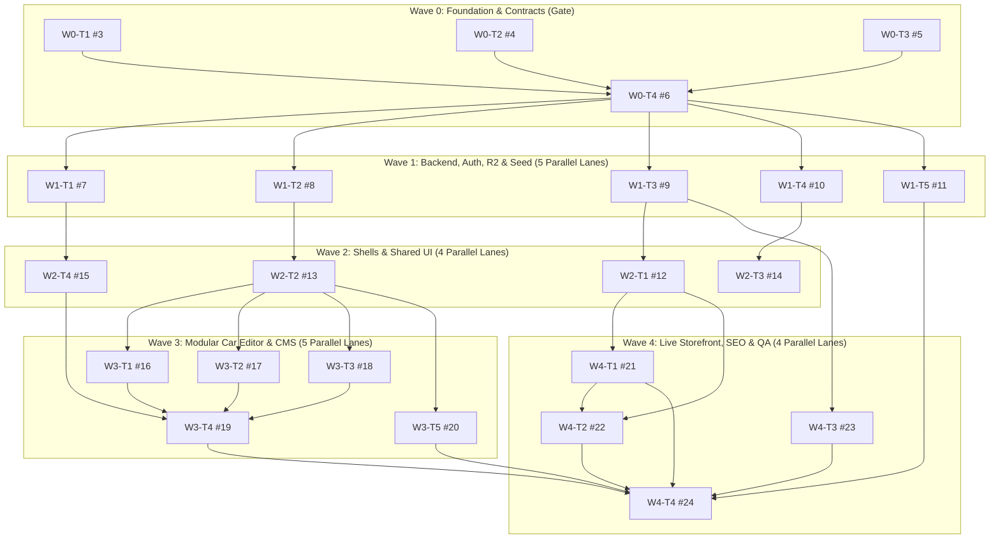

# Handoff & Parallel Task Breakdown: Garasi 571 Dashboard CMS

- **Tanggal:** 2026-11-23
- **Repositori GitHub:** `ytpremfourdeminov/garasi571`
- **Referensi Riset:** Sesi `5b22b543-6fca-4816-a97c-0bee07ee5d15` (40 poin standar data listing mobil)
- **Data Lokal:** `docs/knowledge/` (`Data_Mobil_Bekas_Surakarta (1).xlsx`, `Stok Mobil Surakarta.zip`) & `public/images/cars/`
- **Total Task:** 22 task atomik dalam 5 Wave paralel (100% tersinkron 1:1 dengan GitHub Issues)

---

## Kontrak & Batasan Keras (Wajib Dibaca Sebelum Mulai)

1. **Subdomain Dashboard (Zero `/admin` URL):**
   - **Produksi:** `https://dash.garasi571.deminov.biz.id` (Worker Custom Domain pada Worker `garasi571` di akun `cloudflare-ytpremfourdeminov`)
   - **Lokal:** `http://dash.localhost:3009`
   - User di subdomain `dash.*` hanya melihat path bersih: `/`, `/login`, `/cars`, `/cars/new`, `/cars/$carId`, `/showroom`, `/faqs`, `/team`.
   - Domain publik (`https://garasi571.deminov.biz.id` / `http://localhost:3009`) **wajib mengembalikan 404** untuk path `/admin*` dan `/dash*`.
2. **Proteksi `.env.local`:**
   - **DILARANG mengubah `.env.local`**. File tersebut sudah memuat:
     - `SUPABASE_URL`
     - `SUPABASE_PUBLISHED_KEY`
     - `SUPABASE_DIRECT_CONNECTION_DB_URL`
     - `SUPABASE_DIRECT_TRANSACTION_POOLER_DB_URL`
     - `SUPABASE_DIRECT_SESSION_POOLER_DB_URL`
   - Runtime SSR & Dashboard menggunakan `SUPABASE_URL` + `SUPABASE_PUBLISHED_KEY` dengan Supabase Auth cookies + RLS (tanpa `SUPABASE_SERVICE_ROLE_KEY`).
   - Script seed awal (`W1-T5`) menggunakan `SUPABASE_DIRECT_SESSION_POOLER_DB_URL` / `SUPABASE_DIRECT_CONNECTION_DB_URL`.
3. **Database & Storage:**
   - **Database & Auth:** Supabase project `supabase-garasi571-ytpremfourdeminov` (`https://valtixhuigyavywecmmn.supabase.co`) dengan role `admin` dan `sales` + RLS.
   - **Media Storage:** Cloudflare R2 bucket `garasi571-media` (`cloudflare-ytpremfourdeminov`), binding Worker `MEDIA_BUCKET`, disajikan lewat `GET /media/*` dengan header cache immutable + ETag.
4. **Aturan Paralelisme (Anti Merge Conflict):**
   - Kerjakan **Wave 0 (`W0-T1`..`W0-T4`)** hingga selesai penuh sebelum memecah paralel ke Wave 1.
   - Dalam satu Wave, setiap task memiliki **kepemilikan file eksklusif** (*Exclusive File Ownership*). Jangan memodifikasi file milik task lain pada Wave yang sama.
   - Setelah menyelesaikan sebuah task, perbarui status di GitHub Issue terkait **dan** status pada file `docs/handoff/20261123-1336/tasks/<ID>.md` + tabel di bawah ini agar tetap sinkron.

---

## Diagram Ketergantungan Wave (Parallel DAG)

---

## Master Sync Table (Handoff Docs <-> GitHub Issues)

| Task ID | Wave | Parallel Lane | Judul Task | Dokumen Lokal | GitHub Issue | Dependensi | Status |
| :--- | :--- | :--- | :--- | :--- | :--- | :--- | :--- |
| `W0-T1` | Wave 0 | Gate - Infra & Cloudflare | Provision R2 bucket, custom domain dash.*, wrangler & env helper | [tasks/W0-T1.md](./tasks/W0-T1.md) | [#3](https://github.com/ytpremfourdeminov/garasi571/issues/3) | - | `done` |
| `W0-T2` | Wave 0 | Gate - Dependencies & Supabase Client | Install Supabase/Zod deps and create server/public client factories | [tasks/W0-T2.md](./tasks/W0-T2.md) | [#4](https://github.com/ytpremfourdeminov/garasi571/issues/4) | - | `done` |
| `W0-T3` | Wave 0 | Gate - Database & RLS | Apply Supabase schema migrations, RLS policies & generate DB types | [tasks/W0-T3.md](./tasks/W0-T3.md) | [#5](https://github.com/ytpremfourdeminov/garasi571/issues/5) | - | `done` |
| `W0-T4` | Wave 0 | Gate - Shared Domain Contracts | Lock canonical domain types, Zod schemas, DB mappers & completeness score | [tasks/W0-T4.md](./tasks/W0-T4.md) | [#6](https://github.com/ytpremfourdeminov/garasi571/issues/6) | `W0-T1` (#3), `W0-T2` (#4), `W0-T3` (#5) | `done` |
| `W1-T1` | Wave 1 | Lane A - R2 Storage Pipeline | Build Cloudflare R2 media serving route (/media/*) and upload/delete API | [tasks/W1-T1.md](./tasks/W1-T1.md) | [#7](https://github.com/ytpremfourdeminov/garasi571/issues/7) | `W0-T1` (#3), `W0-T4` (#6) | `open` |
| `W1-T2` | Wave 1 | Lane B - Subdomain Routing & Auth | Implement host-aware subdomain routing (dash.*), Supabase Auth & /login | [tasks/W1-T2.md](./tasks/W1-T2.md) | [#8](https://github.com/ytpremfourdeminov/garasi571/issues/8) | `W0-T2` (#4), `W0-T4` (#6) | `open` |
| `W1-T3` | Wave 1 | Lane C - Public Data Layer | Build public read-only catalog, showroom & FAQ server functions | [tasks/W1-T3.md](./tasks/W1-T3.md) | [#9](https://github.com/ytpremfourdeminov/garasi571/issues/9) | `W0-T2` (#4), `W0-T4` (#6) | `open` |
| `W1-T4` | Wave 1 | Lane D - Dashboard CRUD Server Functions | Build authenticated dashboard CRUD server functions (cars, showroom, FAQs, team) | [tasks/W1-T4.md](./tasks/W1-T4.md) | [#10](https://github.com/ytpremfourdeminov/garasi571/issues/10) | `W0-T2` (#4), `W0-T4` (#6) | `open` |
| `W1-T5` | Wave 1 | Lane E - Initial Data & R2 Seed Script | Build idempotent seed script for 9 local cars, R2 photos, showroom & FAQs | [tasks/W1-T5.md](./tasks/W1-T5.md) | [#11](https://github.com/ytpremfourdeminov/garasi571/issues/11) | `W0-T1` (#3), `W0-T3` (#5), `W0-T4` (#6) | `open` |
| `W2-T1` | Wave 2 | Lane A - Public Route Shell Split | Decouple __root.tsx into minimal HTML root and _public.tsx showroom layout | [tasks/W2-T1.md](./tasks/W2-T1.md) | [#12](https://github.com/ytpremfourdeminov/garasi571/issues/12) | `W1-T3` (#9) | `open` |
| `W2-T2` | Wave 2 | Lane B - Dashboard UI Primitives & Layout | Add dashboard UI primitives and protected dash.tsx layout shell | [tasks/W2-T2.md](./tasks/W2-T2.md) | [#13](https://github.com/ytpremfourdeminov/garasi571/issues/13) | `W1-T2` (#8) | `open` |
| `W2-T3` | Wave 2 | Lane C - Dashboard Overview & Inventory Table | Build dashboard overview (/) and car inventory list (/cars) pages | [tasks/W2-T3.md](./tasks/W2-T3.md) | [#14](https://github.com/ytpremfourdeminov/garasi571/issues/14) | `W1-T4` (#10), `W2-T2` (#13) | `open` |
| `W2-T4` | Wave 2 | Lane D - WebP Compressor & R2 Media Manager | Build client-side WebP compressor and CarMediaManager gallery component | [tasks/W2-T4.md](./tasks/W2-T4.md) | [#15](https://github.com/ytpremfourdeminov/garasi571/issues/15) | `W1-T1` (#7), `W2-T2` (#13) | `open` |
| `W3-T1` | Wave 3 | Lane A - Car Form: Identity & Tech Specs | Build CarIdentitySpecsForm component (identity, specs, odometer) | [tasks/W3-T1.md](./tasks/W3-T1.md) | [#16](https://github.com/ytpremfourdeminov/garasi571/issues/16) | `W0-T4` (#6), `W2-T2` (#13) | `open` |
| `W3-T2` | Wave 3 | Lane B - Car Form: Pricing & Credit Repeater | Build CarPricingCreditForm component (cash, credit & simulation repeater) | [tasks/W3-T2.md](./tasks/W3-T2.md) | [#17](https://github.com/ytpremfourdeminov/garasi571/issues/17) | `W0-T4` (#6), `W2-T2` (#13) | `open` |
| `W3-T3` | Wave 3 | Lane C - Car Form: Legality & Inspection | Build CarLegalityInspectionForm component (tax, docs, inspection & imperfections) | [tasks/W3-T3.md](./tasks/W3-T3.md) | [#18](https://github.com/ytpremfourdeminov/garasi571/issues/18) | `W0-T4` (#6), `W2-T2` (#13) | `open` |
| `W3-T4` | Wave 3 | Lane D - EV/Insights, Completeness Sidebar & Car Editor Pages | Build EV/Video/Insights form, completeness sidebar & /cars/new + /cars/$carId pages | [tasks/W3-T4.md](./tasks/W3-T4.md) | [#19](https://github.com/ytpremfourdeminov/garasi571/issues/19) | `W2-T4` (#15), `W3-T1` (#16), `W3-T2` (#17), `W3-T3` (#18) | `open` |
| `W3-T5` | Wave 3 | Lane E - Showroom, FAQ & Team CMS Pages | Build Showroom & Sales (/showroom), FAQ (/faqs) and Team Role (/team) CMS pages | [tasks/W3-T5.md](./tasks/W3-T5.md) | [#20](https://github.com/ytpremfourdeminov/garasi571/issues/20) | `W1-T4` (#10), `W2-T2` (#13) | `open` |
| `W4-T1` | Wave 4 | Lane A - Public Home & Context Live Wiring | Wire landing page, catalog, compare & showroom components to live Supabase data | [tasks/W4-T1.md](./tasks/W4-T1.md) | [#21](https://github.com/ytpremfourdeminov/garasi571/issues/21) | `W2-T1` (#12) | `open` |
| `W4-T2` | Wave 4 | Lane B - Car Detail Page Research Upgrade | Connect /mobil/$slug to Supabase and render progressive research sections | [tasks/W4-T2.md](./tasks/W4-T2.md) | [#22](https://github.com/ytpremfourdeminov/garasi571/issues/22) | `W2-T1` (#12), `W4-T1` (#21) | `open` |
| `W4-T3` | Wave 4 | Lane C - Dynamic SEO, Sitemap & LLMs.txt | Connect sitemap.xml, llms.txt, llms-full.txt & JSON-LD to live Supabase data | [tasks/W4-T3.md](./tasks/W4-T3.md) | [#23](https://github.com/ytpremfourdeminov/garasi571/issues/23) | `W1-T3` (#9) | `open` |
| `W4-T4` | Wave 4 | Lane D - Seed Execution, Build & E2E QA | Run initial seed to Supabase/R2, verify build, RLS & end-to-end QA | [tasks/W4-T4.md](./tasks/W4-T4.md) | [#24](https://github.com/ytpremfourdeminov/garasi571/issues/24) | `W1-T5` (#11), `W3-T4` (#19), `W3-T5` (#20), `W4-T1` (#21), `W4-T2` (#22), `W4-T3` (#23) | `open` |
